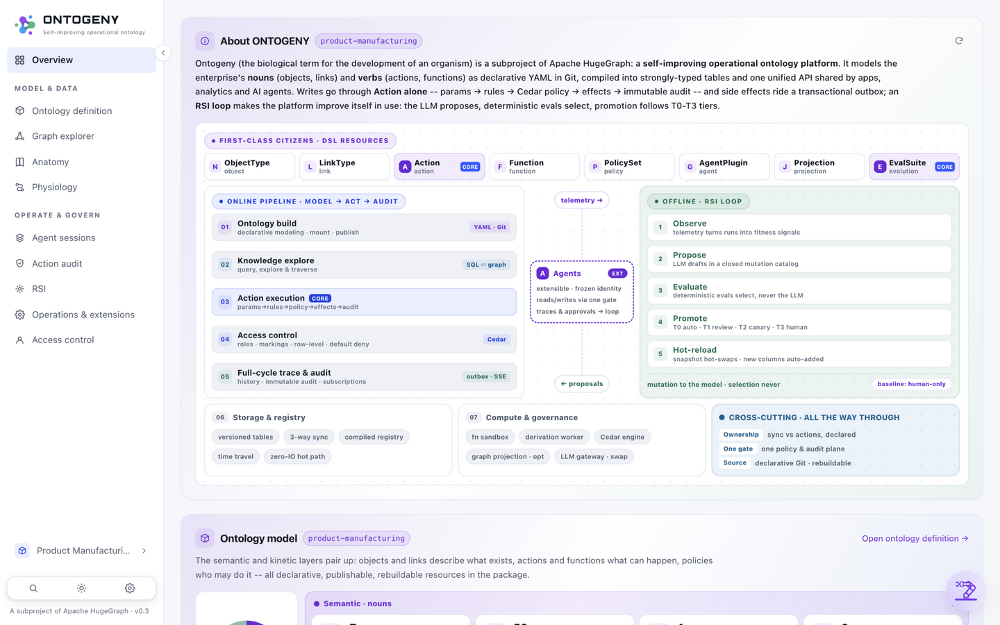
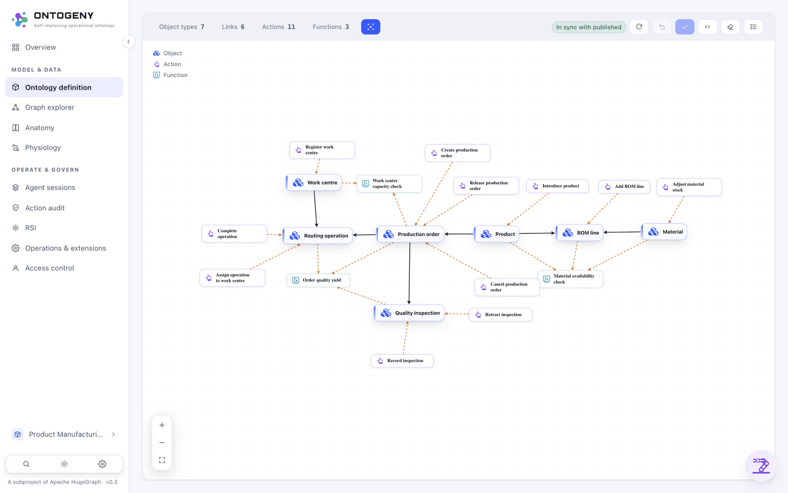
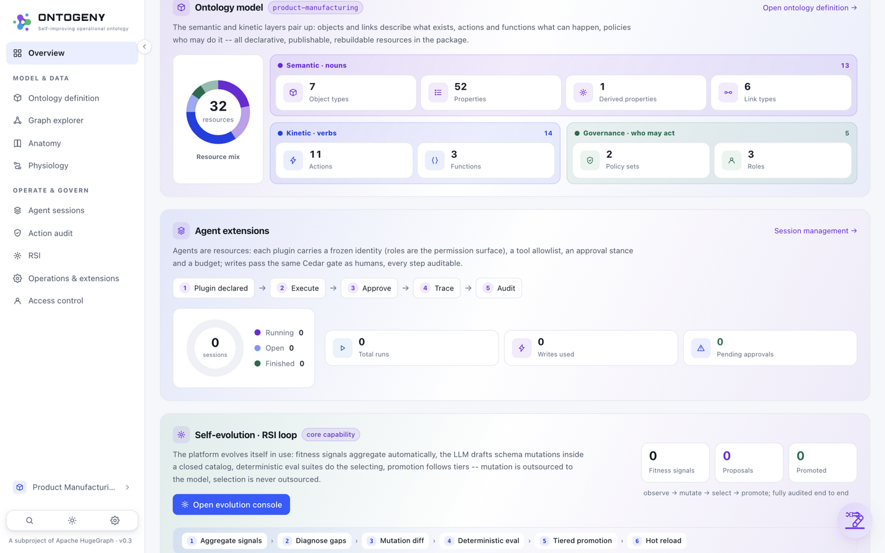
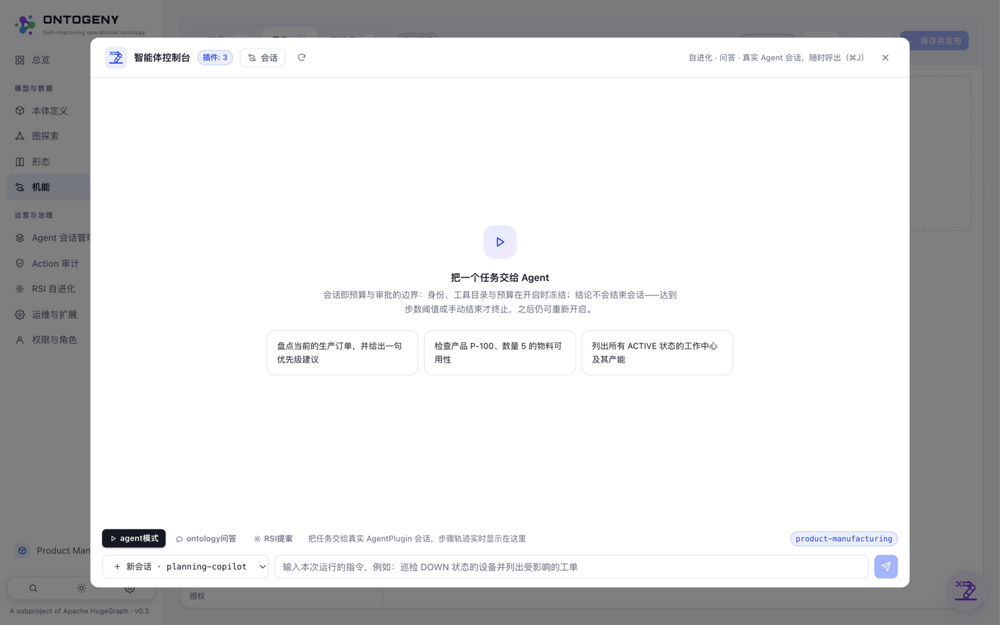
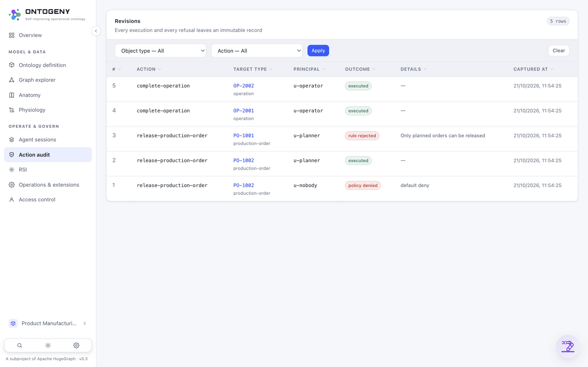

# Ontogeny

[](https://www.apache.org/licenses/LICENSE-2.0.html)
[](https://deepwiki.com/apache/hugegraph-ai)
[](#contributing)
[](#contributing)

`ontogeny` — Greek *onto-* (being, the root of *ontology*) + *genesis* (birth, development): in biology the word names the **full-life-cycle development of an individual organism**. The name is the thesis: an ontology here is not a static schema but a living thing — declared in Git, compiled into tables and a graph, and grown through use. It is a **self-improving operational ontology platform** built on [Apache HugeGraph](https://github.com/apache/hugegraph): it models an enterprise's business semantics (objects, properties, links) and business actions (actions, functions, policies) as declarative, Git-native YAML, and serves them to applications, analytics and AI agents through one governed API — optionally projected onto HugeGraph for deep-graph queries.

The design pairs a **semantic layer** (what the business is) with a **kinetic layer** (what it can do), and stays fully open: **the DSL is the single source of truth** — object tables and the graph schema are compiled artifacts that can be deleted and rebuilt at any time.

The whole system on one board — this is the console's Overview dashboard, and the map for everything below:



*Top: the eight first-class DSL citizens (Action = the only write gate, EvalSuite = the selection box). Middle: the online pipeline (build → explore → act → control → audit) and the offline RSI loop, joined by the agent spine — its reads/writes cross the same gates, its traces and approvals flow back as evolution signals. Bottom: the supporting layer and the three cross-cutting invariants (ownership, one gate, Git as source).*

Contributor workflows: [CI selection and full validation](docs/quality/ci.md), [release preparation](docs/releasing.md).

## ✨ Key Features

- **Git-native ontology** — modeling is YAML + pull requests; consensus happens in code review, not a locked GUI
- **Single-process kernel** — `ontogeny serve` = Registry + query engine + Action runtime on SQLite / Postgres
- **Agent-first** — a governed MCP tool surface at `/mcp`; agents and humans share one policy surface, writes pass human approval gates
- **Self-improving (RSI)** — observe → mutate (LLM-generated DSL diffs) → select (deterministic eval suites) → release (T0 auto-merge / T1 PR / T2 canary); *mutation is outsourced to the LLM, the selection function is not*
- **Constitutional guardrails** — machine proposals travel the same Git/CI channel as humans; policy relaxation, markings and tier definitions always require human review
- **Bilingual enterprise console** — React 19 + TypeScript: ontology canvas (browse *and* edit), graph exploration, action runner, audit, self-evolution console

Modeling is code review, not form-filling — the ontology canvas shows every object, link, action and function of the domain, with references highlighted on hover:



## 🚀 Quick Start

### Option 1: Docker (Recommended)

```bash
git clone https://github.com/apache/hugegraph-ai.git
cd hugegraph-ai/ontogeny

docker compose up -d          # self-contained demo (SQLite + seeded data)
# docker compose --profile postgres up -d   # Postgres-backed
# docker compose --profile graph up -d      # + HugeGraph projection
```

Console + API: **http://localhost:8000** — the first boot creates an `admin` account and prints the generated password to the container log (or preset `ONTOGENY_ADMIN_PASSWORD`). One command gets you a live dashboard seeded with a real manufacturing domain — the ontology model, the agent surface and the RSI loop at a glance:



### Option 2: From Source

```bash
cd ontogeny

# backend (with the MCP extra so /mcp is served)
uv venv && source .venv/bin/activate && uv pip install -e '.[mcp]'

# web console
cd web && npm install && npm run build && cd ..

# one-command demo: seeds a source db, installs the example ontology, serves UI + API
ontogeny serve --demo --open   # → http://127.0.0.1:8000/
```

> [!NOTE]
> The API is session/bearer authenticated. The `X-Ontogeny-Principal` dev header is **enabled by default** for evaluation (`ONTOGENY_DEV_AUTH=0` disables it) — turn it off in production, where the agent surfaces (REST + `/mcp`) then require a signed-in driver and every session records WHO drove it.

## 🤖 Connecting an Agent (MCP)

Point any MCP client (Claude Desktop, ZCode, LangGraph, the `mcp` SDK) at **`http://<host>/mcp`**:

1. `agent_open_session(plugin, task)` — opens a governed session for a declared plugin;
2. call any tool with `plugin` / `session_id` / `thought` — budget, tool catalog, approval gates and the step trail apply identically to the REST session protocol;
3. writes park for human approval in the console; session-less calls are read-only.

The builtin LLM engine drives its sessions over the same MCP surface (in-process), so the transport is exercised in production. In the console, the same surface lives behind the floating icon at the bottom-right of every page — hand a task to a declared plugin from anywhere:



Governance you can point at: every execution and every refusal lands in an immutable audit stream (executed / rule-rejected / policy-denied), and every agent step is attributable and replayable:



## 📦 Modules

### [ontogeny](./ontogeny) — the platform

The self-improving operational ontology platform described above: [`server/ontogeny`](./ontogeny/server/ontogeny) (Python kernel — DSL, registry, versioned stores, five-stage action runtime, Cedar-subset policy, query engine, sandboxed functions, RSI loop, graph projection, agent governance), [`extensions`](./ontogeny/extensions) (llm-ollama / graph-hugegraph / agent-builtin-llm), [`web`](./ontogeny/web) (React 19 + TypeScript console, bilingual EN/zh-CN) and [`domains`](./ontogeny/domains) (the product-manufacturing showcase, which doubles as the test-suite golden package). One `ServiceContext` behind three thin shells — HTTP, MCP and CLI — a single governance channel. See [ontogeny/README.md](./ontogeny/README.md) for the full documentation index.

### Existing modules (hugegraph-ai)

These modules predate Ontogeny and continue to work standalone. **They are being integrated step by step as Ontogeny's core capability modules**, boosting Ontogeny's **graph construction** (knowledge-graph building from text) and **graph reasoning** (GraphRAG-style retrieval and answering) — under Ontogeny's governance: LLM calls through the platform gateway, writes through the Action runtime, tools under the governed MCP surface. Until each stage lands, the boundary is enforced by a zero-coupling gate in CI (the `ontogeny` module does not import `hugegraph_llm` / `hugegraph_ml`).

| Module | What it does today | Role in Ontogeny's roadmap |
|---|---|---|
| [hugegraph-llm-sdk](./hugegraph-llm-sdk) | Standalone SDK for schema design, validation, and reviewed property-graph extraction; see its [integration guide](./hugegraph-llm-sdk/README.md) and [architecture](./docs/sdk/architecture.md) | Provides reusable graph construction capabilities |
| [hugegraph-llm](./hugegraph-llm) | LLM integration for graph applications: **GraphRAG** (retrieval-augmented generation with graph data), **knowledge-graph construction** from text, natural-language graph querying, AI agents for graph reasoning | **Step 2**: GraphRAG Q&A over the ontology's HugeGraph projection; text-to-ontology proposals feeding the RSI loop (LLM proposes, deterministic evals select) |
| [hugegraph-mcp](./hugegraph-mcp) | MCP server for safe HugeGraph access — typed graph/schema/Gremlin/extraction tools, read-only defaults, dry-run and single-use confirmation for writes | Referenced as a library behind Ontogeny's governed MCP surface (one tool surface, not two) |
| [hugegraph-ml](./hugegraph-ml) | Graph machine learning: node classification (GCN, GAT, GraphSAGE, APPNP), graph classification, embeddings (DeepWalk, Node2Vec, GRACE), link prediction (SEAL, GATNE) | **Step 3**: semantic search over objects; analytics as derived signals for the evolution loop |
| [hugegraph-python-client](./hugegraph-python-client) | Full-coverage Python client for HugeGraph (schema management, CRUD, Gremlin, REST), distributed as `hugegraph-python` | Used inside Ontogeny's extensions where full REST coverage is needed (async adapters remain the primary path) |
| [vermeer-python-client](./vermeer-python-client) | SDK for graph computing with [Vermeer](https://github.com/apache/hugegraph-computer/tree/master/vermeer#readme) | **Step 3**: powers `POST /graph/algorithm` (pagerank / community / shortest-path) — results return as ID sets re-assembled through the governed query path |

The LLM application, SDK, Python client and MCP require Python 3.12–3.14. Ontogeny is a standalone package requiring Python 3.10 or later; `hugegraph-ml` is outside the uv workspace and requires Python 3.12 or later. See each module’s README for setup.

## 📚 Learn More

- [Project Homepage](https://hugegraph.apache.org/docs/quickstart/hugegraph-ai/)
- [Ontogeny module docs](./ontogeny/README.md) — architecture & usage documentation index
- [LLM Quick Start Guide](./hugegraph-llm/quick_start.md)
- [Reviewed Property-Graph Extraction](./hugegraph-llm/docs/extraction-runtime.md)
- [DeepWiki AI Documentation](https://deepwiki.com/apache/hugegraph-ai)

## 🔗 Related HugeGraph Projects

1. [hugegraph](https://github.com/apache/hugegraph) (graph's core component - Graph server + PD + Store)
2. [hugegraph-toolchain](https://github.com/apache/hugegraph-toolchain) (graph tools **[loader](https://github.com/apache/hugegraph-toolchain/tree/master/hugegraph-loader)/[dashboard](https://github.com/apache/hugegraph-toolchain/tree/master/hugegraph-hubble)/[tool](https://github.com/apache/hugegraph-toolchain/tree/master/hugegraph-tools)/[client](https://github.com/apache/hugegraph-toolchain/tree/master/hugegraph-client)**)
3. [hugegraph-computer](https://github.com/apache/hugegraph-computer) (integrated **graph computing** system)
4. [hugegraph-website](https://github.com/apache/hugegraph-doc) (**doc & website** code)

## 🤝 Contributing

We welcome contributions! Please see our [contribution guidelines](https://hugegraph.apache.org/docs/contribution-guidelines/) for details.

### 🤖 AI Coding Guidelines for Developers

> [!IMPORTANT] > **For project contributors using AI coding tools**, please follow these guidelines:
>
> - **Start Here**: First read `rules/README.md` for the complete AI-assisted development workflow
> - **Module Context**: When `AGENTS.md` exists in any module, rename it as context for your LLM (e.g., `CLAUDE.md`, `copilot-instructions.md`)
> - **Documentation Standards**: Follow the structured documentation approach in `rules/prompts/project-general.md`
> - **Deep Analysis**: For complex features, refer to `rules/prompts/project-deep.md` for comprehensive code analysis methodology
> - **Code Quality**: Maintain consistency with existing patterns and ensure proper type annotations
> - **Testing**: Follow TDD principles and ensure comprehensive test coverage for new features
>
> These guidelines ensure consistent code quality and maintainable development workflow with AI assistance.

**Development Setup:**

```bash
# 1. Clone and navigate to project
git clone https://github.com/apache/hugegraph-ai.git
cd hugegraph-ai

# 2. Install all development dependencies (upstream workspace)
uv sync --all-extras  # Install all optional dependency groups
source .venv/bin/activate  # Activate for easier command usage

# 3. Run tests for the ontogeny module
cd ontogeny
pytest                                        # backend (live-LLM cases auto-skip)
cd web && npx vitest run && npm run build     # frontend + typecheck + build

# 4. Run tests for the other workspace members
cd ../../hugegraph-llm && pytest
cd ../hugegraph-python-client && pytest

# 5. Format and lint code
cd .. && ./style/code_format_and_analysis.sh
```

### Code Quality (uv + Ruff + ty)

From the repository root:

```bash
uv run --extra dev ruff format --check .
uv run --extra dev ruff check .
uv run --extra dev ty check hugegraph-llm/src/hugegraph_llm hugegraph-python-client/src/pyhugegraph
```

Ruff and ty use `>=` requirements in root `pyproject.toml`.
The [pre-commit hooks](.pre-commit-config.yaml) run Ruff through uv and inherit that range.
Enable hooks with `uv run --extra dev pre-commit install`. CI runs Ruff and affected-module ty
checks in existing runners; application type checks remain advisory while the
existing diagnostic baseline is resolved. See [CI policy](docs/quality/ci.md).

**Key Points:**

- Use [GitHub Desktop](https://desktop.github.com/) for easier PR management
- Check existing issues before reporting bugs

[](https://github.com/apache/hugegraph-ai/graphs/contributors)

## 📄 License

hugegraph-ai is licensed under [Apache 2.0 License](./LICENSE).

## 📞 Contact Us

- **GitHub Issues**: [Report bugs or request features](https://github.com/apache/hugegraph-ai/issues) (fastest response)
- **Email**: [dev@hugegraph.apache.org](mailto:dev@hugegraph.apache.org) ([subscription required](https://hugegraph.apache.org/docs/contribution-guidelines/subscribe/))
- **Slack**: [Join the ASF HugeGraph channel](https://the-asf.slack.com/archives/C059UU2FJ23)
- **WeChat**: Follow "Apache HugeGraph" official account


