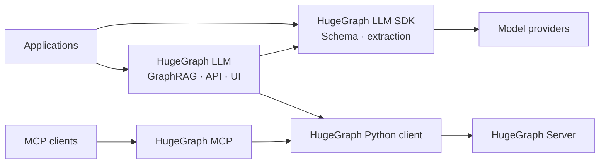

# hugegraph-ai

[](https://www.apache.org/licenses/LICENSE-2.0.html)
[](https://deepwiki.com/apache/hugegraph-ai)

`hugegraph-ai` integrates [HugeGraph](https://github.com/apache/hugegraph) with artificial intelligence capabilities, providing comprehensive support for developers to build AI-powered graph applications.

## ✨ Key Features

- **[LLM/GraphRAG](./hugegraph-llm/README.md#key-features)**: Build intelligent question-answering systems with graph-enhanced retrieval
- **[Knowledge Graph Construction](./hugegraph-llm/README.md#knowledge-graph-construction)**: Automated graph building from text using LLMs
- **[HugeGraph-LLM SDK](./hugegraph-llm-sdk/README.md)**: Design schemas and extract reviewed property graphs in your own Python project, without a UI or database service
- **[Graph ML](./hugegraph-ml/README.md)**: Integration with 20+ graph learning algorithms (GCN, GAT, GraphSAGE, etc.)
- **[HG-Python Client](./hugegraph-python-client/README.md)**: Easy-to-use Python interface for HugeGraph operations
- **[Vermeer Python Client](./vermeer-python-client/README.md)**: SDK/Interface for Graph Computing with [Vermeer](https://github.com/apache/hugegraph-computer/tree/master/vermeer#readme)
- **[MCP Server](./hugegraph-mcp/README.md)**: Connect MCP clients to typed graph tools with read-only defaults and controlled writes

### See it in action

<p align="center">
  
</p>

Build a knowledge graph from text in the HugeGraph RAG interface. See the [knowledge graph construction guide](./hugegraph-llm/README.md#knowledge-graph-construction) for the workflow.

## 🧩 Architecture

The LLM application builds GraphRAG and extraction workflows on the reusable SDK and the HugeGraph Python client. The SDK can also be used by another Python application without the UI or database service. The MCP server offers a separate entry point for MCP clients.



## 🚀 Quick Start

> [!NOTE]
> For a complete deployment guide and detailed examples, please refer to [hugegraph-llm/README.md](./hugegraph-llm/README.md)

### Prerequisites

- Python 3.12–3.14 for the LLM application, SDK, Python client and MCP
- [uv](https://docs.astral.sh/uv/) 0.13.6+ (required for workspace management)
- HugeGraph Server 1.5+ for the Python client and LLM application; `hugegraph-mcp` requires 1.7.0+
- Docker (optional, for containerized deployment)

### Option 1: Docker Deployment (Recommended)

```bash
git clone https://github.com/apache/hugegraph-ai.git
cd hugegraph-ai
```

Before starting Compose, follow the [LLM Docker Compose guide](./hugegraph-llm/README.md#option-1-docker-compose-recommended) to prepare both `docker/.env` and the mounted `hugegraph-llm/.env`, configure `GRAPH_URL` and model credentials, and restrict network access. The supplied Compose file publishes both the Server and unauthenticated RAG API on all host interfaces by default. The guide explains loopback-only bindings and authentication for remote access.

```bash
cd docker
docker compose -f docker-compose-network.yml up -d
docker compose -f docker-compose-network.yml ps
```

With the local loopback bindings described in the guide, HugeGraph Server is available at `http://127.0.0.1:8080` and the RAG service at `http://127.0.0.1:8001`.

### Option 2: Source Installation

```bash
# 1. Start HugeGraph Server
docker run -itd --name=server -p 127.0.0.1:8080:8080 hugegraph/hugegraph

# 2. Clone and set up the project
git clone https://github.com/apache/hugegraph-ai.git
cd hugegraph-ai

# 3. Install dependencies with workspace management
# uv sync automatically creates venv (.venv) and installs base dependencies
uv sync --extra llm  # Install LLM-specific dependencies
# For HugeGraph MCP source development, install its standalone package directly.
# Or install all optional dependencies: uv sync --all-extras

# 4. Activate virtual environment (recommended for easier commands)
source .venv/bin/activate

# 5. Start the demo (no uv run prefix needed when venv activated)
cd hugegraph-llm
python -m hugegraph_llm.demo.rag_demo.app
# Visit http://127.0.0.1:8001
```

The source launcher binds to `127.0.0.1` by default and warns when a non-loopback `--host` is selected. The Server example also binds its port to loopback; configure authentication and network restrictions before remote access.

### Examples

- **GraphRAG**: Follow the [LLM quick start](./hugegraph-llm/quick_start.md) for indexing and querying workflows.
- **Graph machine learning**: Follow the [ML examples](./hugegraph-ml/README.md#examples) for node embedding and classification. The ML module uses a standalone environment outside the uv workspace and requires Python 3.12+ because it uses the local Python client.

## 📦 Modules

### [hugegraph-llm-sdk](./hugegraph-llm-sdk)

HugeGraph-LLM SDK is an independently installable Python interface for reusable LLM capabilities. Its current
scope is schema design, validation, and reviewed property-graph extraction. Inject your own model or install an
optional provider adapter; synchronous and asynchronous APIs share the same graph rules. The SDK and application
are sibling packages: `hugegraph-llm` depends on `hugegraph-llm-sdk`, while external projects can install the SDK
alone. See its [integration guide](./hugegraph-llm-sdk/README.md) for source installation and offline examples,
and [architecture](./docs/sdk/architecture.md) for module responsibilities and extension boundaries.

### [hugegraph-llm](./hugegraph-llm) [](https://deepwiki.com/apache/hugegraph-ai)

Large language model integration for graph applications:

- **GraphRAG**: Retrieval-augmented generation with graph data
- **Knowledge Graph Construction**: Build KGs from text automatically
- **Natural Language Interface**: Query graphs using natural language
- **AI Agents**: Intelligent graph analysis and reasoning

### [hugegraph-mcp](./hugegraph-mcp)

Model Context Protocol server for safe, controlled HugeGraph access:

- **Stable Tool Contract**: Typed graph, schema, Gremlin, and extraction tools for MCP clients
- **Safe Writes**: Read-only defaults plus dry-run, persistent single-use confirmation, and target revalidation
- **Compatibility**: Default `core` toolset with an opt-in `legacy` compatibility mode; the previous `1.7.1` release uses `v2_core` / `v1`

### [hugegraph-ml](./hugegraph-ml)

Graph machine learning with 20+ implemented algorithms:

- **Node Classification**: GCN, GAT, GraphSAGE, APPNP, etc.
- **Graph Classification**: DiffPool, P-GNN, etc.
- **Graph Embedding**: DeepWalk, Node2Vec, GRACE, etc.
- **Link Prediction**: SEAL, GATNE, etc.

> [!NOTE]
> hugegraph-ml is not part of the uv workspace.

### [hugegraph-python-client](./hugegraph-python-client)

Python client for HugeGraph operations, distributed as `hugegraph-python` (`uv pip install hugegraph-python`) and imported as `pyhugegraph`:

- **Schema Management**: Define vertex/edge labels and properties
- **CRUD Operations**: Create, read, update, delete graph data
- **Gremlin Queries**: Execute graph traversal queries
- **REST API**: Complete HugeGraph REST API coverage

## 📚 Learn More

- [Repository Documentation Index](./docs/README.md)
- [Project Homepage](https://hugegraph.apache.org/docs/quickstart/hugegraph-ai/)
- [LLM Quick Start Guide](./hugegraph-llm/quick_start.md)
- [Reviewed Property-Graph Extraction](./hugegraph-llm/docs/extraction-runtime.md) — optional API review, bounded repair, concurrent chunks, and per-chunk results
- [DeepWiki AI Documentation](https://deepwiki.com/apache/hugegraph-ai)

## 🔗 Related HugeGraph Projects

And here are links of other repositories:

1. [hugegraph](https://github.com/apache/hugegraph) (graph's core component - Graph server + PD + Store)
2. [hugegraph-toolchain](https://github.com/apache/hugegraph-toolchain) (graph tools **[loader](https://github.com/apache/hugegraph-toolchain/tree/master/hugegraph-loader)/[dashboard](https://github.com/apache/hugegraph-toolchain/tree/master/hugegraph-hubble)/[tool](https://github.com/apache/hugegraph-toolchain/tree/master/hugegraph-tools)/[client](https://github.com/apache/hugegraph-toolchain/tree/master/hugegraph-client)**)
3. [hugegraph-computer](https://github.com/apache/hugegraph-computer) (integrated **graph computing** system)
4. [hugegraph-website](https://github.com/apache/hugegraph-doc) (**doc & website** code)

## 🤝 Contributing

We welcome contributions! Please see our [contribution guidelines](https://hugegraph.apache.org/docs/contribution-guidelines/) for details.

<details>
<summary>Development setup and quality checks</summary>

Contributor workflows: [CI selection and full validation](docs/quality/ci.md), [release preparation](docs/releasing.md).

Contributors using AI coding tools should read the root and nearest module `AGENTS.md` for repository constraints and test selection. The [AI-assisted workflow](rules/README.md) provides optional guidance for changes that need further analysis or planning.

**Development setup:**

```bash
# From the repository root
uv sync --all-extras
uv run --extra dev pre-commit install
```

Run tests for the modules affected by your change; the [CI policy](docs/quality/ci.md) and module READMEs describe the appropriate test commands. For SDK or Python client changes, also validate the relevant `hugegraph-llm` callers.

### Code Quality (uv + Ruff + ty)

From the repository root:

```bash
uv run --extra dev ruff format --check .
uv run --extra dev ruff check .
uv run --extra dev ty check hugegraph-llm/src/hugegraph_llm hugegraph-python-client/src/pyhugegraph
uv run --extra dev ty check hugegraph-llm-sdk/src/hugegraph_llm_sdk
```

Ruff and ty use `>=` requirements in root `pyproject.toml`.
The [pre-commit hooks](.pre-commit-config.yaml) run Ruff through uv and inherit that range.
Enable hooks with `uv run --extra dev pre-commit install`. CI runs Ruff and affected-module ty
checks in existing runners; application type checks remain advisory while the
existing diagnostic baseline is resolved. See [CI policy](docs/quality/ci.md).

</details>

**Key Points:**
- Use [GitHub Desktop](https://desktop.github.com/) for easier PR management
- Check existing issues before reporting bugs

[](https://github.com/apache/hugegraph-ai/graphs/contributors)

## 📄 License

hugegraph-ai is licensed under [Apache 2.0 License](./LICENSE).

## 📞 Contact Us

- **GitHub Issues**: [Report bugs or request features](https://github.com/apache/hugegraph-ai/issues) (fastest response)
- **Email**: [dev@hugegraph.apache.org](mailto:dev@hugegraph.apache.org) ([subscription required](https://hugegraph.apache.org/docs/contribution-guidelines/subscribe/))
- **Slack**: [Join the ASF HugeGraph channel](https://the-asf.slack.com/archives/C059UU2FJ23)
- **WeChat**: Follow "Apache HugeGraph" official account


