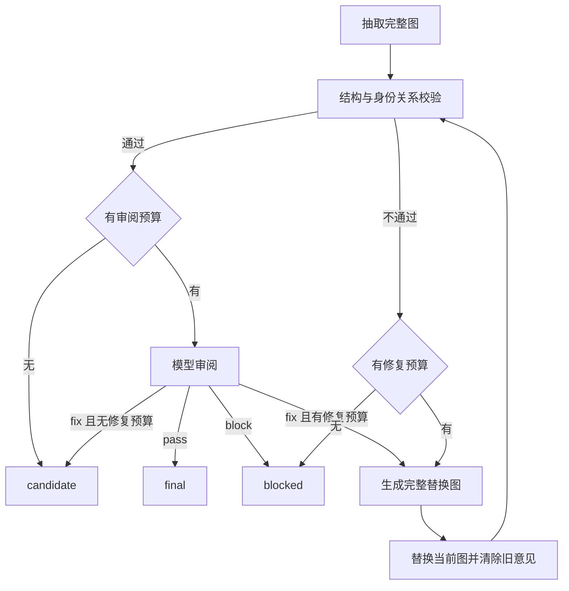

# 第一版属性图抽取、审阅与修复

该实现通过现有 `POST /graph/extract` 的可选 `review_options` 启用。未提供选项或传入 null 时继续使用旧路径。使用方法与可运行示例见[运行指南](extraction-runtime.md)。

## 职责与调用链

```text
HTTP → GraphExtractService → Scheduler → GraphExtractFlow
    → SchemaNode / ChunkSplitNode → ExtractNode
    → batch → 每块 engine + PropertyGraphBundle + 现有模型客户端
    → 主线程汇总 → Flow.post_deal → HTTP 响应
```

| 模块 | 职责 |
| --- | --- |
| `v1/contracts.py` | 块输入、预算选项、问题、审阅与块结果 |
| `v1/engine.py` | 单块循环、调用次数、当前图与终态 |
| `v1/batch.py` | 有限并发、独立领域对象、输入顺序与失败隔离 |
| `property_graph.py` | 调用现有模型，解析、规范化、校验、审阅和完整图修复 |
| `ExtractNode` | 为每块创建模型客户端，收集结果后一次写回工作流状态 |

领域接口只有 `extract / validate / review / repair`。执行器不承担提示词、schema 规则、图数据库写入或模型传输职责。属性图实现复用现有模型客户端和抽取提示词；审阅、修复提示词同样放在现有 `PromptConfig` 中。

## 当前图与审阅循环

抽取后先做结构、属性、主键和关系端点检查。校验可以对当前块图进行确定性的 ID 与端点规范化，但不会提前丢弃无效条目。缺失或不满足 schema 的部分进入问题列表，供修复使用。

结构有效时才调用模型审阅。审阅以原文、schema 与当前图为输入，检查事实支持、属性错误、关系方向和明确遗漏，输出 `pass / fix / block` 与问题列表。



每次成功修复后直接替换当前图，清空旧轮次问题，重新校验和审阅。修复调用失败保留之前得到的图与对应问题，并将块标记为 failed。抽取、审阅或修复的解析/模型异常同样结束当前块，其他块继续返回结果。解析错误不会伪装成空图成功；合法空图仍要经过校验和审阅。

## 预算与终态

默认 `max_reviews=2`、`max_fixes=1`、`max_workers=4`。审阅与修复按调用尝试计数，失败尝试也计入；本地校验不计模型调用。每块执行器层模型调用最多 `1 + max_reviews + max_fixes` 次，不包括底层客户端的传输重试。执行器本身不再增加重试层。

选项必须为整数：`max_reviews` 范围为 0–5，`max_fixes` 为 0–3，`max_workers` 为 1–8。布尔值、小数、数字字符串、超出范围的值和未知字段（例如误写为 `max_review`）都会在抽取开始前返回 HTTP 422。空对象仍采用默认值；未提供选项或传入 null 仍使用旧抽取路径。最大设置允许每块最多 9 次执行器层模型调用，每个请求最多同时处理 8 块；它不限制单次输出 token、输入块总数或所有请求的总并发。

`max_reviews=0` 仅跳过模型审阅，仍执行抽取、本地校验，以及 `max_fixes` 预算内必要的修复。没有经过审阅的图不能成为 final：有效图停留在 candidate，顶层状态为 failed，汇总 `result.vertices/edges` 为空，但图仍保留在 `chunk_results` 供检查。它不会切换到旧抽取模式；需要旧行为时应省略 `review_options` 或传入 null。`max_fixes=0` 仅禁用修复。

审核路径显式启用模型客户端的 `raise_on_truncation=True`：OpenAI/LiteLLM 的 `finish_reason=length` 和 Ollama 的 `done_reason=length` 都会在解析前返回对应阶段的 failed 块，并在 reason 中保留对应的截断标记。普通客户端默认关闭该选项，保留既有的截断内容返回行为；是否抛出截断异常与是否设置输出 token 上限分别配置。审核路径还保留 OpenAI 请求错误和认证错误的异常类型，避免把它们误报为 JSON 解析错误；普通客户端保留既有的错误返回行为。

| 终态 | 含义 |
| --- | --- |
| `final` | 当前图通过校验和最新审阅 |
| `candidate` | 当前图结构有效，但审阅次数耗尽，或要求修复而修复次数耗尽 |
| `blocked` | 必要校验在修复预算内未通过，或审阅明确拒绝 |
| `failed` | 模型、解析、执行或每块准备发生异常 |

块结果包含当前图、当前问题、结束原因、失败阶段和调用次数。修复后若审阅预算已经耗尽，返回新图的 candidate，问题中不再保留旧图的审阅结论。

## 并发与响应

batch 限制同时准备和执行的块数量。每块有独立的领域对象、模型客户端、图、问题与计数器；返回顺序始终等于输入顺序。它一次提交并保留有限批次，不提供流式调度或跨块合并。

ExtractNode 在分发块前深拷贝一份当前 LLM 配置，所有块及各阶段均使用这份快照。UI 或 HTTP 配置更新只影响后续请求；配置快照与 LLM 配置写入共用锁，模型执行不持锁。新快照会等待正在进行的配置更新（包括连通性检查）结束。同一运行时锁还保护图配置和受保护的索引刷新，因此这些操作也可能延迟新快照的建立。

ExtractNode 汇总 final 块的 vertices/edges，并保留全部 `chunk_results`。全部块 final 时顶层为 succeeded，部分 final 时为 partial，没有 final 时为 failed。已完成的业务请求仍可返回 HTTP 200，调用方必须检查这些状态。合法空图可为 final，不以实体数量判断成功。

工作流输入、状态及返回链都传递审阅选项和分块结果，复用工作流时清理，避免影响后续旧模式调用。`chunk_results` 不受 `include_meta` 控制；旧模式不增加该字段。inline schema 不需要连接 HugeGraph；原有图名 schema 继续使用请求的 client_config。

## 验证与边界

确定性测试使用脚本化模型输出，执行实际 parser、validator、engine、batch，并覆盖 HTTP 到 Scheduler/pycgraph/Node 的返回链。真实模型烟测通过指南中的例子运行；自动化通过不能代替模型质量验证。

第一版不包含多层指纹、语义 manifest、不可变图版本、通用 Provider 适配、哈希链轨迹、独立 final gate、持久化任务、图写入或跨块实体消歧。合并只按输入顺序拼接 final 图，不解决跨块重复与冲突。
