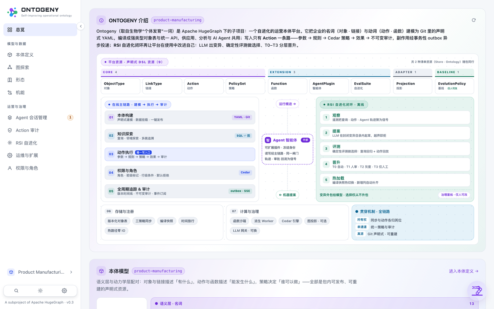

# 08 · Quick Start（QUICK START · ONE COMMAND）

> Part of [Part II · Usage](../README.md#part-ii--usage)

**[中文](../../zh/usage/08-quickstart.md)** | English

## 8.1 Start from source

Install Python 3.12+, Node.js 22+ and uv first. Run the following from the directory containing your repository clone. The MCP extra provides `/mcp`; the frontend build provides the console.

```bash
cd hugegraph-ai/ontogeny  # from the directory containing your clone
uv venv --python 3.12 && source .venv/bin/activate && uv pip install -e '.[mcp]'
cd web && npm ci && npm run build && cd ..
ontogeny serve --demo --open        # → http://127.0.0.1:8000/ (UI and API on one port)
# optionally attach an LLM (shared by the assistant + the RSI proposer):
ONTOGENY_LLM_BASE_URL=http://127.0.0.1:11434 ONTOGENY_LLM_MODEL=qwen3:27b ontogeny serve --demo --open
```

`--demo` creates `.ontogeny-demo/` for the seeded `erp.db` source and the metadata/object database. By default it serves `domains/chip-lifecycle` **in place**, so console model edits change that working copy. Add `--copy-package` to keep the editable package under `.ontogeny-demo/pkg/` instead. State survives restarts; `--reseed` rebuilds the source and copied demo state while retaining in-place model edits. An explicit `--db` or `ONTOGENY_DB_DSN` overrides the demo database location.

For containers, run `docker compose up -d` from `ontogeny/`. The image includes the MCP extra and built UI, copies the package into the persistent `/data` volume and binds to `127.0.0.1:8000` by default. Retrieve the initial password with `docker compose exec ontogeny cat /data/admin-bootstrap-password`. See the [module guide](../../../README.md#optional-databases-and-graph-projection) for Postgres and external HugeGraph overrides.

Already have a domain package? Sidebar domain switcher → **New domain → Import ontology package**, upload a zip — validate-install-activate in one step.

## 8.2 First login

A fresh deployment auto-creates an `admin` account; unless `ONTOGENY_ADMIN_PASSWORD` was preset, the generated high-entropy password is saved to the owner-only `admin-bootstrap-password` file in the demo data directory (default `.ontogeny-demo`, or `/data` in Compose). Logs show its path, never the password; read it from another terminal with `cat .ontogeny-demo/admin-bootstrap-password`. Change the password after login and securely delete the file. After logging in you land on the Overview dashboard: Ontogeny intro & overall architecture, the ontology model, agents and the RSI loop — four sections on one screen.



**Overview (the landing page)** — the first screen is the Ontogeny introduction with the overall architecture board; the left rail is the global navigation (Model & data / Operate & govern); the dashboard numbers come from the real compiled snapshot and seeded data, not static decoration.

Production authentication is enabled by default. `ONTOGENY_DEV_AUTH=1` enables identity simulation through `X-Ontogeny-Principal`; use it only in a local development environment. Source serving binds to `127.0.0.1` unless `--host` is explicitly supplied.

## 8.3 The minimal viable package (only 2 resources)

The taxonomy has a surface of 11 resources and an **entry threshold of 2**: one `Store` + one `ObjectType` is enough to load, validate and query. `Action` / `PolicySet` / `Function` / `AgentPlugin` / `Projection` / `EvalSuite` / `EvolutionPolicy` may all be absent.

```yaml
# ontology.yaml
apiVersion: ontogeny/v1
kind: Ontology
metadata: { name: my-domain }
spec: {}
```

```yaml
# stores/main.yaml
apiVersion: ontogeny/v1
kind: Store
metadata: { name: main }
spec: { type: sqlite, connection: "${MY_DSN}", access: read-write }
```

```yaml
# objects/product.yaml
apiVersion: ontogeny/v1
kind: ObjectType
metadata: { name: product, display: Product }
spec:
  primaryKey: [product_id]
  properties:
    product_id: { type: string, required: true }
    name: { type: string }
  backing: { store: main, source: { table: product }, mapping: {} }
```

Once `ontogeny validate` passes, publish it. What each of the nine platform resources solves and why they cannot be merged: [00 · Kind Taxonomy](../architecture/00-kind-taxonomy.md).
