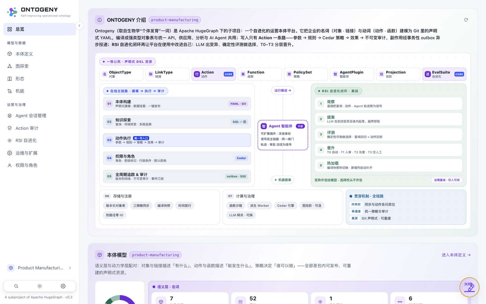

# 08 · 快速开始（QUICK START · ONE COMMAND）

> 所属：[使用文档](../README.md#第二部分--使用文档part-ii--usage)

**中文** | [English](../../en/usage/08-quickstart.md)


## 8.1 从源码启动

先安装 Python 3.12+、Node.js 22+ 与 uv。以下命令从克隆仓库的上级目录执行；MCP extra 提供 `/mcp`，前端构建提供控制台。

```bash
cd hugegraph-ai/ontogeny  # 从克隆仓库的上级目录进入模块
uv venv --python 3.12 && source .venv/bin/activate && uv pip install -e '.[mcp]'
cd web && npm ci && npm run build && cd ..
ontogeny serve --demo --open        # → http://127.0.0.1:8000/（UI 与 API 同端口）
# 可选接大模型（助手 + RSI 提案器共用）：
ONTOGENY_LLM_BASE_URL=http://127.0.0.1:11434 ONTOGENY_LLM_MODEL=qwen3:27b ontogeny serve --demo --open
```

`--demo` 创建 `.ontogeny-demo/`，保存播种源库 `erp.db` 与元数据/对象数据库。默认直接使用 `domains/product-manufacturing`，控制台模型编辑会修改该工作副本。添加 `--copy-package` 可将可编辑包保存在 `.ontogeny-demo/pkg/`。重启会保留状态；`--reseed` 重建源库与复制模式的演示状态，保留原位模式下的模型编辑。显式 `--db` 或 `ONTOGENY_DB_DSN` 会覆盖演示数据库路径。

容器部署请在 `ontogeny/` 中运行 `docker compose up -d`。镜像已安装 MCP extra 并构建界面，将本体包复制到持久化卷 `/data`，默认仅绑定 `127.0.0.1:8000`。通过 `docker compose exec ontogeny cat /data/admin-bootstrap-password` 读取初始密码。Postgres 和外部 HugeGraph 的 override 配置见[模块指南](../../../README.md#optional-databases-and-graph-projection)。

已有领域包？侧栏域切换器 → **新域 → 导入本体包**，上传 zip 即可校验、安装并激活。

## 8.2 首次登录

全新部署会自动创建管理员 `admin`。若未预先设置 `ONTOGENY_ADMIN_PASSWORD`，生成的 6 位数字密码保存在演示数据目录的 `admin-bootstrap-password` 文件中，只有文件所有者可访问（默认 `.ontogeny-demo`，Compose 中为 `/data`）。日志只显示文件路径；可在另一个终端运行 `cat .ontogeny-demo/admin-bootstrap-password` 读取。登录后请修改密码并安全删除该文件。登录后落在运行看板：Ontogeny 介绍与总体架构、本体模型、智能 Agent 与 RSI 自进化闭环四个区块一屏可览。



**运行看板（登录后首页）** —— 首屏即 Ontogeny 介绍与总体架构图；左侧为全局导航（模型与数据 / 运营与治理），看板数字来自真实编译快照与种子数据，非静态装饰。

默认启用生产鉴权。`ONTOGENY_DEV_AUTH=1` 会允许通过 `X-Ontogeny-Principal` 模拟身份，仅用于本地开发。源码服务默认绑定 `127.0.0.1`，只有显式传入 `--host` 才会改变监听地址。
